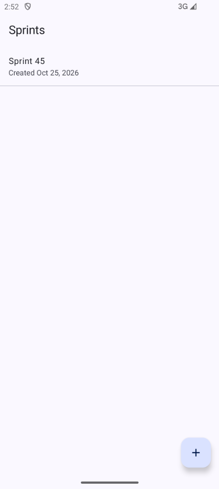
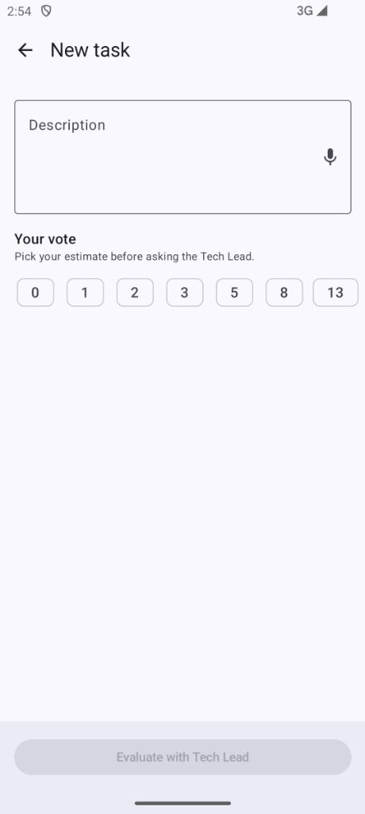
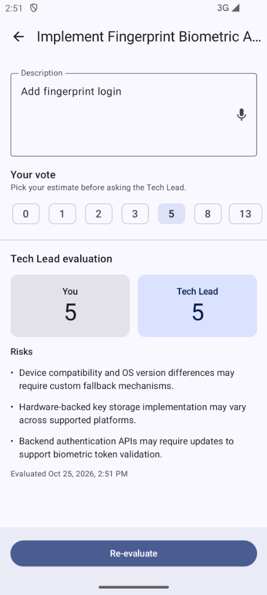
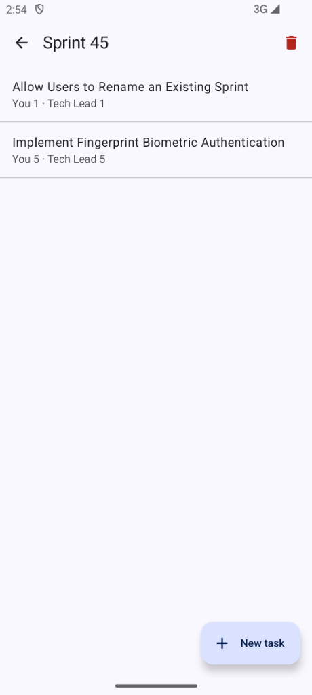

# 🃏 Planning Poker AI

**Planning Poker AI** is an Android application designed for solo agile estimation rounds. Engineers describe a task (via text or voice) and commit to their own complexity estimate **before** consulting an independent AI **Senior Tech Lead** powered by Gemini.

By withholding the user's vote from the AI prompt, the app prevents cognitive anchoring and surfaces hidden technical and scope risks alongside an unbiased story-point comparison.

---

## 📌 Table of Contents
- [How It Works](#-how-it-works)
- [Spec-Driven Development (OpenSpec)](#-spec-driven-development-openspec)
- [Architecture & Module Graph](#-architecture--module-graph)
- [Tech Stack](#-tech-stack)
- [TODOs & Roadmap](#-todos--roadmap)
- [References](#-references)

---

## 🎯 How It Works

1. **Organize by Sprints:** Create local sprints to group tasks and track estimation history offline.
2. **Describe & Vote First (Anti-Anchoring):** Describe a task by typing or using **Speech-to-Text** in your device's language and select a complexity score on the scale (`0, 1, 2, 3, 5, 8, 13, 20, ?`).
3. **Unbiased Tech Lead Evaluation:** The AI receives **only** the task description and device language—never your vote, sprint metadata, or previous evaluations. It returns a structured JSON response containing a concise **Title**, a story-point **Estimate** (`0–20`), and concrete **Technical/Scope Risks**.
4. **Compare & Refine:** Compare your estimate against the AI Tech Lead's vote, adjust the task scope if needed, and re-evaluate at any time.

### 📱 App Walkthrough

| 1. Sprints Dashboard | 2. New Task & User Vote | 3. Tech Lead AI Evaluation | 4. Sprint Task History |
| :---: | :---: | :---: | :---: |
|  |  |  |  |
| *Create and browse local sprints ordered newest first.* | *Describe the task (text or voice) and lock in your vote first.* | *Compare your vote with the AI Tech Lead's estimate and risks.* | *Review all estimated tasks inside the sprint.* |

---

## 📋 Spec-Driven Development (OpenSpec)

This repository follows a **Spec-Driven Development** workflow powered by [**OpenSpec**](./openspec/config.yaml). Every epic is specified through a **Proposal**, **Architectural Design**, **Behavioral Specs (Given/When/Then scenarios)**, and an actionable **Task Breakdown** before implementation:

| Epic / Change | OpenSpec Artifacts | GitHub Tracking |
| :--- | :--- | :--- |
| **1. Bootstrap & Foundation** | [Proposal](./openspec/changes/bootstrap-foundation/proposal.md) · [Design](./openspec/changes/bootstrap-foundation/design.md) · [Tasks](./openspec/changes/bootstrap-foundation/tasks.md) | [Epic #1](https://github.com/pasqualinigustavo/planningpoker/issues/1) ([Story 1.1](https://github.com/pasqualinigustavo/planningpoker/issues/2), [Story 1.2](https://github.com/pasqualinigustavo/planningpoker/issues/3)) |
| **2. Sprint Management** | [Proposal](./openspec/changes/add-sprint-management/proposal.md) · [Design](./openspec/changes/add-sprint-management/design.md) · [Spec](./openspec/changes/add-sprint-management/specs/sprint-management/spec.md) · [Tasks](./openspec/changes/add-sprint-management/tasks.md) | [Epic #4](https://github.com/pasqualinigustavo/planningpoker/issues/4) ([Story 2.1](https://github.com/pasqualinigustavo/planningpoker/issues/5), [Story 2.2](https://github.com/pasqualinigustavo/planningpoker/issues/6), [Story 2.3](https://github.com/pasqualinigustavo/planningpoker/issues/7)) |
| **3. Planning Poker & Tech Lead AI** | [Proposal](./openspec/changes/add-task-estimation/proposal.md) · [Design](./openspec/changes/add-task-estimation/design.md) · [Task Spec](./openspec/changes/add-task-estimation/specs/task-estimation/spec.md) · [AI Spec](./openspec/changes/add-task-estimation/specs/tech-lead-agent/spec.md) · [Tasks](./openspec/changes/add-task-estimation/tasks.md) | [Epic #8](https://github.com/pasqualinigustavo/planningpoker/issues/8) ([Story 3.1](https://github.com/pasqualinigustavo/planningpoker/issues/9), [Story 3.2](https://github.com/pasqualinigustavo/planningpoker/issues/10), [Story 3.3](https://github.com/pasqualinigustavo/planningpoker/issues/11), [Story 3.4](https://github.com/pasqualinigustavo/planningpoker/issues/12)) |

- **Project Board:** [Planning Poker AI - Kanban](https://github.com/users/pasqualinigustavo/projects/1)
- **MVP Milestone:** [Milestone #1 — MVP](https://github.com/pasqualinigustavo/planningpoker/milestone/1)

---

## 🏗️ Architecture & Module Graph

The project is structured around Google's official [**Now in Android (NiA)**](https://github.com/android/nowinandroid) modular architecture, enforcing strict separation of concerns, unidirectional data flow (UDF), and reusable Gradle convention plugins in `build-logic/convention`.

```text
                              :app
                                |
                +---------------+---------------+
                |                               |
                v                               v
        :feature:sprints                 :feature:tasks
                |                               |
                +---------------+---------------+
                                |
                +---------------+---------------+
                |                               |
                v                               v
            :core:ui                       :core:data
                |                               |
        +-------+-------+             +---------+---------+
        |               |             |         |         |
        v               |             v         v         |
:core:designsystem      |      :core:database :core:ai    |
                        |             |         |         |
                        +-------------+----+----+---------+
                                           |
                                           v
                                      :core:model
```

- **`:app`** — Application shell, `@HiltAndroidApp`, App Check initialization, and root `NavHost`.
- **`:feature:sprints` & `:feature:tasks`** — Self-contained UI and `ViewModel` layers (features never depend on each other).
- **`:core:ui` & `:core:designsystem`** — Shared domain-aware composables, Material 3 theme (`PlanningPokerTheme`), and Paparazzi visual snapshot tests.
- **`:core:data`** — Offline-first repositories coordinating local persistence and AI evaluation.
- **`:core:database`** — Room database, entities, DAOs, exported schemas, and automated migrations (`v1 -> v2`).
- **`:core:ai`** — `TechLeadAgent` interface and Gemini implementation using strict response schemas (`FirebaseSDK` never leaks outside this module).
- **`:core:model`** — Pure Kotlin/JVM domain models (`Sprint`, `Task`, `Vote`, `TaskEvaluationRequest`, `TaskEvaluationResult`).

---

## 🛠️ Tech Stack

- **Language & Concurrency:** Kotlin 2.2, Coroutines, `StateFlow`, `kotlinx-serialization`
- **Build System:** Gradle Version Catalogs (`libs.versions.toml`) + Custom Convention Plugins (`build-logic`) targeting `compileSdk 36` / `minSdk 26` (Java 17)
- **UI & Navigation:** Jetpack Compose (BOM), Material 3 (Dynamic Color + Light/Dark fallback), Type-Safe Navigation Compose 2.9, Android `RecognizerIntent` (Speech-to-Text)
- **Dependency Injection:** Dagger Hilt (`ksp`)
- **Local Persistence:** Room (`ksp`) with exported schemas and `AutoMigration`
- **AI & Security:**
  - **Firebase AI Logic (`firebase-ai`)** with Gemini Developer API (`GenerativeBackend.googleAI()`) and enforced JSON `responseSchema`
  - **Firebase App Check** (`PlayIntegrityAppCheckProviderFactory` in release, `DebugAppCheckProviderFactory` isolated to the `debug` source set)
- **Testing:** JUnit 4, Coroutines Test, Cash App **Turbine** (Flow testing), Cash App **Paparazzi** (JVM UI snapshot testing), and Room `MigrationTestHelper`

---

## 🗺️ TODOs & Roadmap

Upcoming architectural and product evolutions specified in **OpenSpec** and tracked on **GitHub Issues**:

| Roadmap Epic / Change | OpenSpec Artifacts | GitHub Tracking |
| :--- | :--- | :--- |
| **4. App Settings & Custom Voting Scales** | [Proposal](./openspec/changes/add-settings-and-voting-scales/proposal.md) · [Design](./openspec/changes/add-settings-and-voting-scales/design.md) · [Settings Spec](./openspec/changes/add-settings-and-voting-scales/specs/app-settings/spec.md) · [Sprint Spec](./openspec/changes/add-settings-and-voting-scales/specs/sprint-management/spec.md) · [Task Spec](./openspec/changes/add-settings-and-voting-scales/specs/task-estimation/spec.md) · [AI Spec](./openspec/changes/add-settings-and-voting-scales/specs/tech-lead-agent/spec.md) · [Tasks](./openspec/changes/add-settings-and-voting-scales/tasks.md) | [Epic #16](https://github.com/pasqualinigustavo/planningpoker/issues/16) ([Story 4.1](https://github.com/pasqualinigustavo/planningpoker/issues/17), [Story 4.2](https://github.com/pasqualinigustavo/planningpoker/issues/18), [Story 4.3](https://github.com/pasqualinigustavo/planningpoker/issues/19), [Story 4.4](https://github.com/pasqualinigustavo/planningpoker/issues/20)) |
| **5. KMP Foundation & iOS Shell Preparation** | [Proposal](./openspec/changes/prepare-kmp-ios-foundation/proposal.md) · [Design](./openspec/changes/prepare-kmp-ios-foundation/design.md) · [Tasks](./openspec/changes/prepare-kmp-ios-foundation/tasks.md) | [Epic #21](https://github.com/pasqualinigustavo/planningpoker/issues/21) ([Story 5.1](https://github.com/pasqualinigustavo/planningpoker/issues/22), [Story 5.2](https://github.com/pasqualinigustavo/planningpoker/issues/23), [Story 5.3](https://github.com/pasqualinigustavo/planningpoker/issues/24)) |

### Planned Deliverables

- [ ] **⚙️ [Epic 4: App Settings & Custom Voting Scales](https://github.com/pasqualinigustavo/planningpoker/issues/16)**
  - **Theme Selection ([Story 4.2](https://github.com/pasqualinigustavo/planningpoker/issues/18)):** Switch between **System Default**, **Light**, and **Dark** themes in a new `:feature:settings` screen backed by Jetpack DataStore and `androidx.core:core-splashscreen` (preventing any wrong-theme flash on cold start).
  - **Per-Sprint Voting Scale & DB Migration `v2 -> v3` ([Story 4.1](https://github.com/pasqualinigustavo/planningpoker/issues/17), [Story 4.3](https://github.com/pasqualinigustavo/planningpoker/issues/19), [Story 4.4](https://github.com/pasqualinigustavo/planningpoker/issues/20)):** Choose between **Fibonacci** (`0, 1, 2, 3, 5, 8, 13, 20, ?`) and **T-Shirt Sizes** (`XS, S, M, L, XL, XXL, ?`). Each Sprint stores its immutable `voting_system` (`AutoMigration(2, 3)` defaults existing sprints to `FIBONACCI`), dynamically driving both the `TaskScreen` chips and the Tech Lead AI's `responseSchema`.
- [ ] **📱 [Epic 5: Kotlin Multiplatform (KMP) Foundation & iOS Shell](https://github.com/pasqualinigustavo/planningpoker/issues/21)**
  - **Shared Core Migration ([Story 5.1](https://github.com/pasqualinigustavo/planningpoker/issues/22), [Story 5.2](https://github.com/pasqualinigustavo/planningpoker/issues/23)):** Migrate `:core:model` (`kotlin.time.Instant`), `:core:database` (Room KMP + `BundledSQLiteDriver`), `:core:ai` (`commonMain` agent, prompt, parser, and public `TechLeadModel` transport), and `:core:data` to `commonMain` targeting Android, `iosArm64`, and `iosSimulatorArm64`.
  - **`:shared` Umbrella & `iosApp/` Xcode Shell ([Story 5.3](https://github.com/pasqualinigustavo/planningpoker/issues/24)):** Export a static `Shared` framework with `IosDependencyContainer` and bootstrap the `iosApp/` SwiftUI Xcode shell (preparing the foundation for a future iOS UI epic).

---

## 📚 References

- [Now in Android — Architecture & Modularization Guide](https://github.com/android/nowinandroid)
- [Guide to Android App Modularization](https://developer.android.com/topic/modularization)
- [Firebase AI Logic (Gemini API) Documentation](https://firebase.google.com/docs/ai-logic)
- [Firebase App Check with Play Integrity](https://firebase.google.com/docs/app-check/android/play-integrity-provider)
- [Paparazzi — Snapshot Testing for Android](https://github.com/cashapp/paparazzi)
